<a href="https://www.nikhilkr.in">
  <picture>
    <source media="(prefers-color-scheme: dark)" srcset="assets/header-dark.svg">
    
  </picture>
</a>

[Gibwork](https://gib.work?utm_source=github&utm_medium=referral&utm_campaign=profile&ref=nick) is an app to earn, send and receive money, where every payment is guaranteed by escrow. I've worked across all of it: web, mobile, backend and payments.

| Project | What it is | |
|:--|:--|--:|
| [Gibwork](https://gib.work?utm_source=github&utm_medium=referral&utm_campaign=profile&ref=nick) | Earn, send and receive money, guaranteed by escrow | 60K+ users |
| [MyWall](https://www.mywall.fun) | My projects, posts and quotes on one open canvas |  |
| [Usage Desk](https://usage-desk.nikhilkr.in) | Codex and Claude quotas in the Mac menu bar | Open source |
| [The Wall](https://the-wall.nikhilkr.in) | Quotes I keep coming back to, on slow moving strips | Open source |
| [Hunchlane](https://hunchlane.xyz) | A research desk for a first business idea | Open source |
| [Xcrow](https://xcrow.dev) | Solana escrow for developers | $15K prize |

[nikhilkr.in](https://www.nikhilkr.in) · [X](https://x.com/nikhilkr_tw) · [LinkedIn](https://www.linkedin.com/in/nikhilkr-li/) · hi@nikhilkr.in
